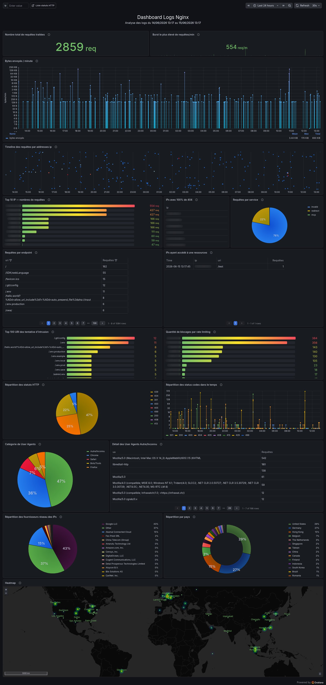
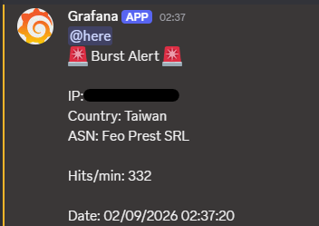
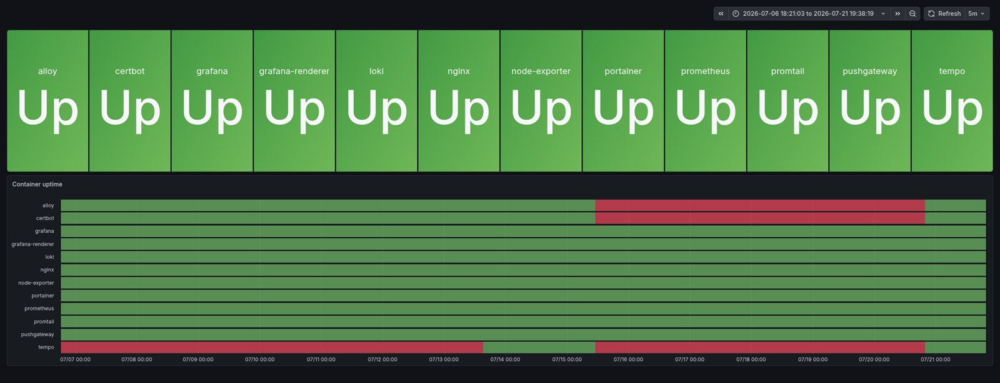
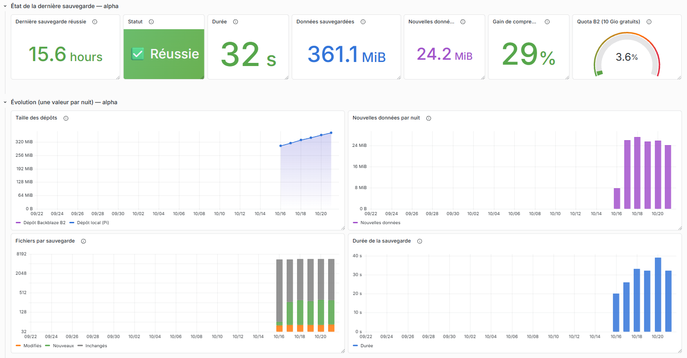
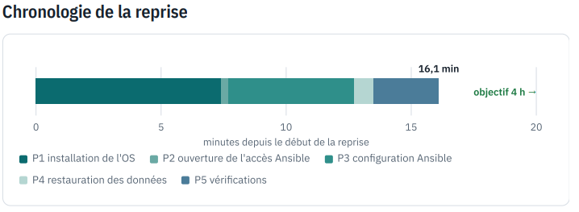
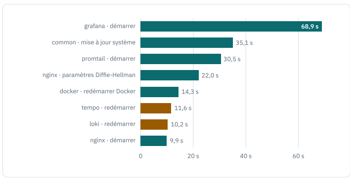


  Sommaire généré par kramdown à partir des titres ## et ### de la fiche :
  une nouvelle étape y apparaît d'elle-même, sans rien retoucher ici.

<nav class="sommaire" aria-label="{{ site.data.ui.sommaire }}" markdown="1">

{{ site.data.ui.sommaire }}

* Sommaire
{:toc}

</nav>

## Contexte et objectif

J'ai commencé ce homelab en parallèle de mes études, pour mettre directement en application ce
que j'apprenais, et surtout pour apprendre des choses que le programme ne couvrait pas.

Il est vite devenu le seul endroit où je subis les conséquences de mes propres décisions
d'exploitation dans la durée : un service qui tombe, un certificat qui expire, une machine qui
redémarre sans que tout revienne. C'est ce qui en fait un terrain d'apprentissage différent
d'un travail pratique, où l'environnement est remis à zéro à la fin.

Il a d'abord été mon environnement d'étude pour les cours, sans aucun service hébergé. Les étapes
ci-dessous commencent avec le premier, en novembre 2025, et suivent son évolution de la plus
ancienne à la plus récente. Il tourne aujourd'hui sur un Raspberry Pi 5 sous Ubuntu Server.

## Étape 1 : une installation à la main

En novembre 2025, j'ai installé Nginx directement sur la machine, avec Certbot pour les
certificats, pour exposer mes applications vers l'extérieur en reverse proxy. J'y ai ajouté un
VPN OpenVPN afin de tester mes applications sur mon réseau quand j'étais en déplacement, en me
connectant en SSH.

## Étape 2 : la migration vers Docker

C'est la maintenance qui m'a fait changer d'approche : à mesure que les services s'accumulaient,
tenir cette installation à jour devenait compliqué. J'ai donc tout migré vers Docker, en
commençant par Nginx et Certbot. Portainer est arrivé en février 2026, pour gérer mes
conteneurs depuis une interface web, puis d'autres services, notamment de supervision.

## Étape 3 : la supervision

### Les journaux Nginx, enrichis et visualisés dans Grafana

L'idée de la supervision est venue en regardant le volume de requêtes que recevait Nginx. Je
voulais analyser ses journaux de façon plus visuelle : entre mai et juin 2026, je les ai
enrichis puis envoyés dans Grafana.

Ça passe par Promtail, qui ne se contente pas de collecter les journaux depuis les conteneurs
Docker : il fait un parsing JSON, une résolution GeoIP via GeoLite2 City (ville, pays,
coordonnées) et une résolution ASN pour le fournisseur réseau, à partir de bases mises à jour
tous les trois jours. J'ai configuré Nginx pour émettre ses journaux directement en JSON
structuré, pour que Grafana construise ses visualisations directement dessus.

En analysant les requêtes, le constat a été immédiat : beaucoup de robots scannent le serveur,
et sur des points d'entrée très variés. Le tableau de bord fait ressortir des tentatives
répétées sur des chemins caractéristiques comme `/.git/config`, `/.env` et toutes ses variantes,
`/owa/` ou encore `/SDK/webLanguage`, avec des agents utilisateurs d'outils de scan automatisés.

Sur une journée type, cela représente 2859 requêtes, avec un pic à 554 requêtes par minute. La
limitation de débit absorbe à elle seule 47 % du trafic en réponses HTTP 429 : le filtrage stoppe
net une bonne partie des tentatives avant qu'elles n'aillent plus loin. Le trafic se concentre sur
quelques origines, 43 % passant par les centres de données de Google LLC, et deux pays dominent le
classement, les États-Unis et l'Allemagne, à eux deux plus de la moitié des requêtes.

Le site public sert aussi de pot de miel : des routes leurres permettent d'étiqueter les
tentatives d'intrusion dans les journaux.

Sur ce même flux, j'ai aussi testé le système d'alertes de Grafana en me faisant avertir à chaque
pic de cent requêtes par minute depuis une même adresse. La notification part sur Discord, qui
me prévient sur l'ordinateur comme sur le téléphone, avec l'adresse IP concernée, sa
localisation et son fournisseur.

### Un tableau de bord pour l'état de santé des conteneurs

À côté des métriques système et des
journaux, je voulais un signal simple : est-ce que chaque service tourne, oui ou non. Un script
relève l'état des conteneurs toutes les cinq minutes et le pousse vers Prometheus via
pushgateway. Ce tableau de bord affiche l'état de chaque conteneur et son historique de
disponibilité dans le temps.

### Les difficultés de cette étape

**Un service éteint, sans la moindre erreur.** Le tableau de bord des conteneurs m'a permis de
résoudre une panne qui n'apparaissait nulle part dans les journaux : un service était simplement arrêté, sans
message d'erreur. En croisant les informations, j'ai pu faire le lien avec un facteur extérieur
qui avait provoqué l'extinction de la machine. Les conteneurs ne s'étaient pas rallumés au
redémarrage du homelab, à cause d'un oubli dans leur configuration, que j'ai corrigé.

**Loki n'indexe pas le corps des journaux.** Contrairement à une base de données classique, il
n'indexe que les labels explicitement renseignés. Corréler les données efficacement impose donc
de bons compromis dès la conception : décider à l'avance quels champs deviennent des labels.

## Étape 4 : toute la configuration versionnée dans Git, déployée par Ansible

### Le point de départ : une configuration éparpillée sur la machine

En octobre 2026, un état des lieux du serveur a montré que sa configuration n'existait que sur
la machine elle-même, éparpillée à plusieurs endroits :

- les fichiers Compose réels étaient enfermés dans la base de Portainer, et les 7 copies
  présentes sur le disque ne leur correspondaient plus, dont deux avec des écarts fonctionnels
  (une politique de redémarrage et des options de Prometheus) ;
- des secrets saisis à la main dans l'interface de Portainer n'étaient sauvegardés nulle part ;
- les tâches planifiées étaient réparties dans plusieurs crontabs écrites à la main ;
- les tableaux de bord et les alertes Grafana avaient été créés dans l'interface, dont une règle
  d'alerte devenue invisible ;
- la sauvegarde copiait les configurations avec `rsync` vers un dépôt Git privé, mais jamais
  les données : historique Prometheus, journaux Loki, base Grafana, certificats ;
- le certificat HTTPS était bien renouvelé, mais Nginx ne le rechargeait jamais.

Si la carte SD lâchait, il fallait tout refaire de mémoire, pendant des heures voire des jours,
et les données étaient perdues. L'objectif : que tout soit décrit dans un dépôt Git, d'où l'on
peut reconstruire le serveur, puis le vérifier par un exercice chronométré.

### L'architecture cible

| Élément | Rôle |
|---|---|
| Raspberry Pi 5, 8 Go, Ubuntu Server | Production : site public en HTTPS et supervision, 12 conteneurs |
| Machine virtuelle Ubuntu Server | Test : reçoit chaque changement avant la production |
| Poste Windows avec WSL | Dépôt Git et exécution d'Ansible |
| Ansible | Système, Docker et 9 stacks Docker Compose |
| Nginx et Certbot | Reverse proxy, HTTPS public |
| Prometheus, Loki, Tempo | Métriques, journaux et traces |
| Promtail, Alloy, node-exporter, pushgateway | Collecte |
| Grafana | Tableaux de bord et alertes, envoyées sur Discord |
| restic et Backblaze B2 | Sauvegarde chiffrée, en local et hors site |
{: .tableau-machines }

Le même code sert aux deux machines, alors que le Raspberry Pi est en ARM64 et la VM en AMD64 :
le dépôt Docker est choisi selon le processeur détecté. Entre la production et le test, seules
des variables changent, par exemple un certificat auto-signé et aucune sauvegarde planifiée sur
la VM.

### La migration, de la machine vers le dépôt

| Date | Étape |
|---|---|
| 12 octobre | VM de test, accès SSH, inventaire des deux machines, état des lieux du serveur |
| 13 octobre | Premiers rôles Ansible pour le système et Docker ; les 9 stacks sont rapatriées depuis Portainer dans le dépôt |
| 13 et 14 octobre | Secrets chiffrés avec Ansible Vault ; migration des 7 premières stacks en 4 lots, en sauvegardant chaque volume avant ; tableaux de bord versionnés |
| 15 octobre | Alertes Discord décrites dans Git ; migration de Nginx avec ses certificats et de Promtail avec GeoIP ; healthcheck sous Ansible |
| 16 octobre | Sauvegardes restic vers Backblaze B2, avec métriques et alertes ; première restauration de la production sur la VM |
| 17 octobre | Exercice de reprise chronométré |

Chaque élément qui vivait sur la machine a trouvé sa place dans le dépôt :

- **Les fichiers Compose** sont versionnés et déployés par un rôle Ansible. Le déploiement
  ne redémarre que la stack qui a changé, et supprime du serveur les fichiers retirés
  du dépôt.
- **Les secrets**, 7 au total (clés du stockage cloud, mot de passe restic, webhook Discord,
  jeton Grafana, licence GeoIP), sont chiffrés avec Ansible Vault. Ils arrivent sur le serveur
  dans des fichiers `.env` en droits 0600 et n'apparaissent jamais dans les sorties d'Ansible.
  Trois éléments restent hors du dépôt, dans un gestionnaire de mots de passe : la clé SSH, le
  mot de passe du vault et celui de restic.
- **Les tâches planifiées** sont déclarées dans Ansible au lieu d'être écrites dans des
  crontabs.
- **Les 6 tableaux de bord Grafana** sont versionnés. Pour en modifier un, je le change dans
  l'interface, je l'exporte avec un script, puis je le commite ; les tableaux de bord
  provisionnés sont verrouillés dans l'interface. Les sources de données portent un identifiant
  fixe, leur nom, pour qu'un tableau de bord fonctionne sur n'importe quelle machine
  reconstruite.
- **Les 3 règles d'alerte**, leur point de contact et leur modèle de message sont décrits dans
  Git. La règle invisible existait encore en base, mais son dossier avait disparu : on ne la
  voyait ni dans l'interface ni dans l'API. Elle a été recréée dans le dépôt.
- **Le système** lui-même est décrit : paquets, SSH par clé uniquement, mises à jour de sécurité
  automatiques. Nginx recharge désormais le certificat périodiquement.

Au total, 5 rôles Ansible et 49 tâches. Relancé une deuxième fois, le playbook ne modifie plus
rien : Ansible affiche `changed=0`. Chaque changement passe d'abord par la VM, puis par la
production en mode `--check --diff`, qui montre ce qui changerait sans rien toucher, et
seulement ensuite pour de vrai.

### Des sauvegardes qui incluent les données

L'ancien script est remplacé par restic, chaque nuit à 3 h : tous les volumes Docker et les
configurations, chiffrés côté client, dans un dépôt local puis copiés hors site chez Backblaze
B2, dans l'offre gratuite de 10 Go. Grafana, Prometheus et Loki sont arrêtés pendant la copie
locale pour que leurs données restent cohérentes, soit 5 à 17 secondes de coupure. La rétention
garde 7 sauvegardes quotidiennes, 4 hebdomadaires et 6 mensuelles, et l'intégrité est contrôlée
chaque dimanche.

Chaque sauvegarde publie ses métriques vers un tableau de bord, avec deux alertes Discord :
dernière sauvegarde réussie il y a plus de 26 heures, et plus de 80 % du quota B2 utilisé. La
restauration tient en une commande.

### L'exercice de reprise

Le scénario : perte totale du serveur de production, reconstruit sur une machine vierge à partir
de Git et de la sauvegarde hors site. L'exercice a eu lieu en octobre 2026, sur la VM de test
réinstallée de zéro.

Les objectifs viennent d'une analyse d'impact. Aucun service n'est critique : une coupure du
site public ne fait perdre que la journalisation des tentatives d'intrusion, et celle de la
supervision ne gêne que moi. D'où un délai de reprise (RTO) de moins de 4 heures, et une perte
de données tolérée (RPO) de 24 heures au plus, qui découle de la sauvegarde nocturne. Un premier
objectif de 45 minutes avait été fixé en écrivant le script, d'après ce que l'outil semblait
pouvoir tenir ; je l'ai remplacé par celui déduit de l'analyse d'impact.

Un script de reprise en Bash, d'environ 380 lignes, déroule l'exercice : il chronomètre chaque
phase, s'arrête pour les étapes manuelles, peut reprendre un exercice interrompu, exige de taper
le nom de la cible avant de toucher la production, et produit un rapport.

Le serveur est reconstruit en 16 minutes avec ses données, pour un objectif de 4 heures. La
restauration a ramené 368,5 Mio en 5 secondes, 7 volumes sur 7. La sauvegarde utilisée datant de
3 h du matin, la perte de données s'élève à 15 h 24, sous l'objectif de 24 heures. Les
15 contrôles automatiques passent :

La configuration par Ansible a pris 5 minutes. Le détail des tâches les plus longues montre deux
redémarrages inutiles, ceux de Tempo et de Loki juste après la création de leur stack : les
supprimer ferait gagner environ 25 secondes au premier déploiement.

Ces 16 minutes supposent une machine disponible : après une panne matérielle, il faut y ajouter
le temps d'obtenir un support de remplacement. L'installation du système pèse à elle seule 46 %
du temps total et concentre 3 des 4 interventions manuelles.

### Les difficultés de cette étape

**Grafana qui refusait de démarrer en production.** Déclarer les sources de données dans Git a
changé leur identifiant, et Grafana ne démarrait plus. J'ai rétabli le service en quelques
minutes en retirant le fichier, puis reproduit le problème sur la VM avec une copie des données
de production, où je l'ai corrigé avant de revenir en production. Le test sur la VM, avec une
base Grafana sans ces données, ne l'avait pas révélé.

**`sudo-rs` et Ansible.** Le nouveau `sudo`, réécrit en Rust et livré par défaut avec la version
d'Ubuntu installée, casse la saisie du mot de passe par Ansible, un bug connu. Contournement :
des droits d'administration sans mot de passe, limités à l'utilisateur d'Ansible.

**Deux échecs qui venaient de l'outil de contrôle.** Au premier exercice de reprise, 2 contrôles
sur 14 échouaient. La reprise était bonne : c'était l'outil de contrôle qui se trompait. Les
contrôles ont été réécrits puis relancés, et passent à 15 sur 15.

## Bilan

| | Avant | Après |
|---|---|---|
| Source de vérité | Portainer et des copies désynchronisées | Un dépôt Git |
| Reconstruire le serveur | Inconnu, de mémoire, sans les données | 16 minutes mesurées, avec les données |
| Données sauvegardées | Configurations seulement | Volumes, certificats et configurations |
| Copie hors site | Aucune | Chiffrée, quotidienne, vérifiée |
| Secrets | Saisis à la main, non sauvegardés | Chiffrés dans le dépôt |
| Tester un changement | Directement en production | Sur la VM, puis `--check --diff` en production |

- Journaux Nginx centralisés et enrichis par localisation et fournisseur réseau.
- Alertes jusqu'au téléphone : rafales de requêtes, sauvegarde trop ancienne, quota de stockage.
- Une panne réelle diagnostiquée grâce à la supervision, et sa cause corrigée.
- Passage à Ansible mené en cinq jours, du premier commit à l'exercice de reprise réussi.

Cette pile de supervision ne sert plus seulement au homelab : je l'ai réutilisée telle quelle
sur mes autres projets, mon agent IA et mon lab Windows/Linux, qui remontent leurs métriques
vers ce même Grafana.
